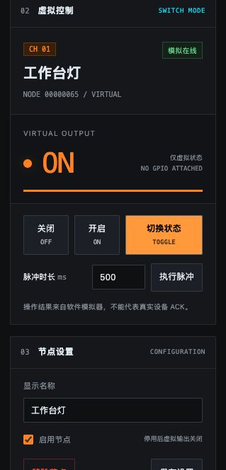

# NowCtrl — DRAFT / 草稿

> **项目仍处于草稿阶段，当前不可使用。** 代码、协议和管理页面均未完成产品集成与实机验证，不能用于实际开关控制、模玩遥控或连接任何真实负载。页面中的在线状态、GPIO 和动作反馈均为软件模拟，不代表设备可用。
>
> **DRAFT — NOT READY FOR USE.** This repository is an unfinished development draft, not a usable firmware release. Do not deploy it to control real switches, RC models, motors, servos or other loads.

A lightweight ESP-NOW wireless control system for switches, RC models, and other DIY projects, built with Rust and Embassy.

## Current status

- Available for development reference: native protocol/control tests, a local management simulator, and client/server examples that compile with virtual output callbacks.
- Incomplete: production pairing/encryption, firmware radio/task integration, Flash persistence, embedded SoftAP/HTTP and physical output adapters.
- Unverified: real-board boot/radio exchange, output safety and RC failsafe. ESP-EMU currently blocks at RTOS startup.
- Commands below are for development and software previews only; successful compilation or a simulated ACK does not make the project ready to use.

## Roadmap

- ESP32-C3 Controller + multiple Nodes
- ESP-NOW discovery, physical pairing and logical channel ordering
- BOOT button selection and LED feedback
- Temporary protected SoftAP and HTTP management
- Switch actions and RC continuous input with explicit failsafe
- Measured power management and safe GPIO extensions

## Build

Rust **1.99.1** and the ESP32-C3 target are selected by `rust-toolchain.toml`.
Dependencies use one pinned esp-rs revision and the included `Cargo.lock`.

```sh
cargo build --locked --release
cargo build --locked --release --no-default-features --features node
```

These direct commands share Cargo's output path. To retain a separate ELF and
merged flash image for each role, install espflash **4.4.0** and use:

```sh
python3 sim/esp-emu/p0.py build controller
python3 sim/esp-emu/p0.py build node
```

See [ESP-EMU instructions](sim/esp-emu/README.md) for pinned tools and bounded
startup checks, and [P0 validation](docs/validation/p0.md) for logs, current RTOS
startup blocker and physical-board procedures. No physical board profile, radio
exchange, phone HTTP or AP coexistence has been verified.

## Management software preview



*管理页预览：软件模拟环境，图中的节点状态与控制反馈不代表真实设备。*

```sh
python3 tools/dev_server.py --port 8080
```

Open [the local workbench](http://127.0.0.1:8080). It follows [DESIGN.md](DESIGN.md)
and supports simulated pairing, rename/enable, channel reorder, confirmed removal,
virtual control and event logs. Device presets distinguish switch control, held
RC actions and read-only GPIO fallback for undefined devices. No device is required. All online/ACK values are
explicitly simulated; the service is not connected to ESP-NOW. Configuration is
saved locally and virtual outputs restart OFF. See [usage](web/README.md) and
[software validation](docs/validation/software.md).

## Device client/server examples

Start with [the customization guide](examples/README.md):

- [Switch client](examples/switch/client.rs) + [switch server](examples/switch/server.rs): commands, ACK, retries and virtual output callbacks.
- [RC client](examples/rc/client.rs) + [RC server](examples/rc/server.rs): continuous preset updates and watchdog-to-neutral callbacks.
- [Host loopback](examples/host/loopback.rs): run the same packet helpers and business logic without hardware.

```sh
cargo run --locked --example host_loopback --features host-examples --target aarch64-apple-darwin
```

The four ESP32-C3 examples require `--features device-examples` and explicit peer
MAC configuration. They use unencrypted lab-only unicast and virtual outputs;
actual radio operation and hardware output safety have not been verified.

## Native protocol checks

The `no_std` library exposes v1 packet encoding/decoding, virtual switch state,
ACK/retry/deduplication and button/LED timing. It is not yet connected to the P0
radio discovery loop.
Hardware dependencies are compiled only for bare-metal targets.

```sh
# macOS Apple Silicon; use x86_64-unknown-linux-gnu on Linux x86_64
cargo test --locked --lib --target aarch64-apple-darwin
cargo clippy --locked --lib --target aarch64-apple-darwin -- -D warnings
cargo fmt --check
```

GitHub Actions checks native tests, formatting, lint, emulator-checker tests and
both firmware roles. These checks do not require a board or certify radio
operation. See [P1 native validation](docs/validation/p1.md) for tested cases and
remaining control-loop work.

The authoritative design is [SPEC.md](SPEC.md); remaining work and acceptance
gates are in [PLAN.md](PLAN.md). The P0 baseline follows the official
[Embassy ESP-NOW duplex example](https://github.com/esp-rs/esp-hal/tree/c21d5741a8fdecb9e01b196e55b7c7859360bf1b/examples/esp-now/embassy_esp_now_duplex).

MIT license.
